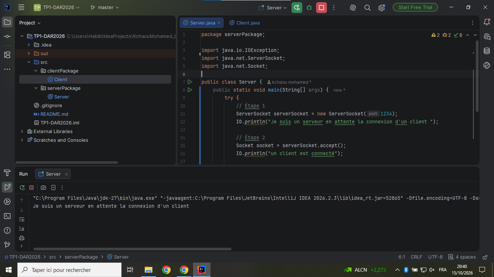
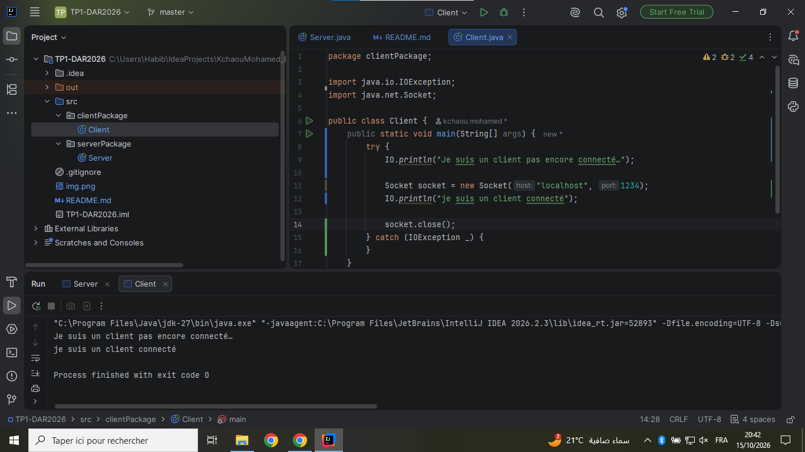
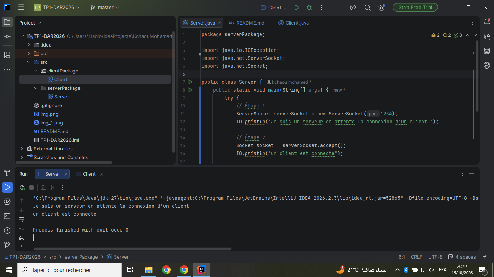

# TP1 — Activité 1-1 : Première connexion client/serveur

**Mohamed Kchaou** · LSI 3 · Développement d’applications réparties

## Objectif

Créer une première connexion TCP en Java entre un client et un serveur, puis afficher les informations de connexion.

## Fonctionnement

Le serveur écoute sur le port `1234`, attend un client, accepte la connexion et affiche son adresse. Le client se connecte à `localhost:1234`, confirme la connexion puis ferme sa socket. Cette version traite une connexion à la fois.

## Exécution

1. Lancer `Server.java` et laisser le serveur en attente.
2. Lancer `Client.java` dans un autre terminal ou depuis l’IDE.
3. Vérifier le message de connexion côté client et l’adresse du client côté serveur.

Les deux programmes utilisent le port `1234`. Pour connecter deux machines, remplacer `localhost` dans le client par l’adresse IP de la machine serveur.

## Captures

## Environnement

Le sujet indique un JDK à partir de la version 8. Les sources présentes dans ce dépôt utilisent `java.io.IO.println` et le nom de paramètre `_`, visibles dans les captures sous JDK 27 ; elles nécessitent donc un JDK récent. Pour un JDK plus ancien, remplacer `IO.println` par `System.out.println` et `_` par un nom de variable.

## Synthèse

Cette activité vérifie l’établissement d’une connexion TCP et l’échange des informations de socket. Aucun message applicatif n’est encore envoyé.
