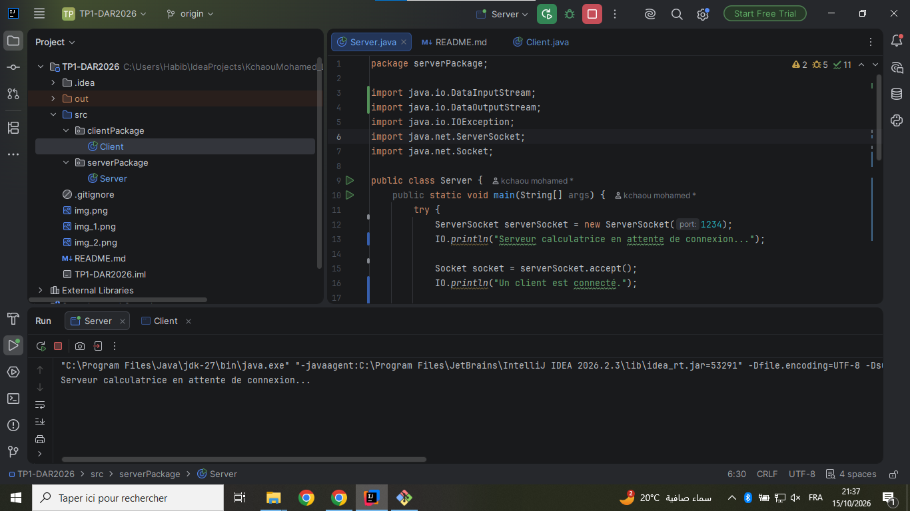
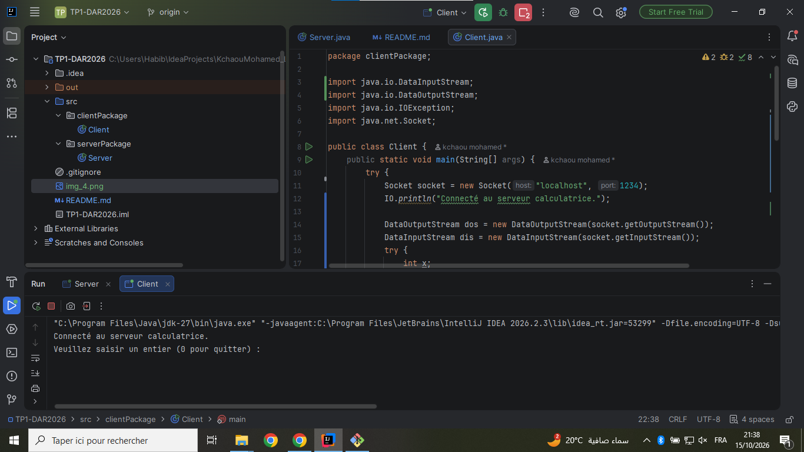
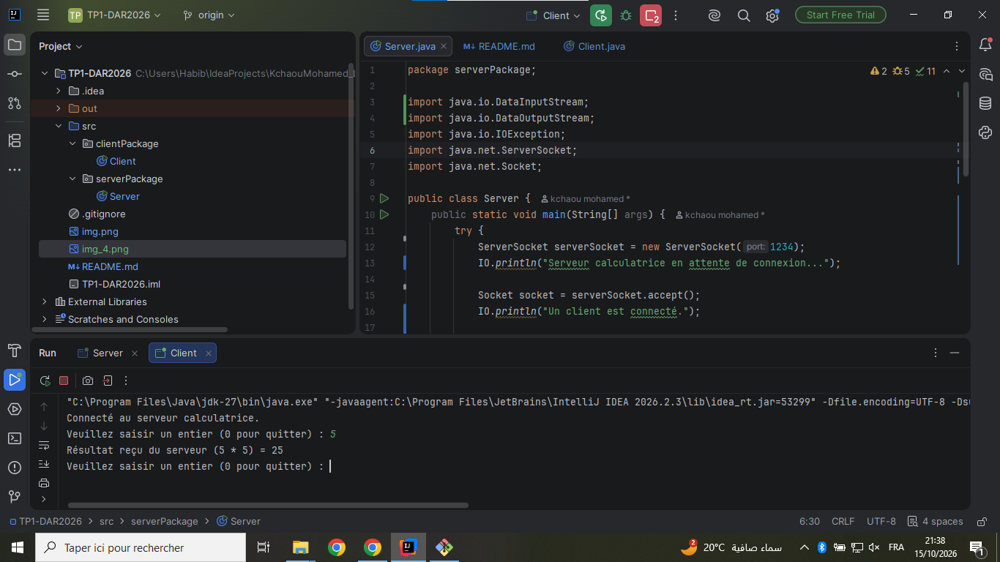
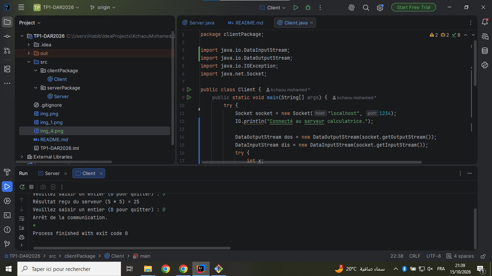

# TP1 — Activité 1-2 : Échange d’entiers

**Mohamed Kchaou** · LSI 3 · Développement d’applications réparties

## Objectif

Faire évoluer le client/serveur TCP pour échanger des entiers et renvoyer un résultat calculé par le serveur.

## Fonctionnement

Le client envoie successivement des entiers avec des flux de données. Le serveur multiplie chaque valeur par `5`, renvoie le résultat, puis attend la valeur suivante. L’envoi de `0` termine l’échange et ferme la connexion.

## Exécution

1. Lancer `Server.java` sur le port `1234`.
2. Démarrer `Client.java` dans un second terminal.
3. Essayer des valeurs positives et négatives, puis saisir `0` pour terminer.

Le client utilise `localhost`. Pour une connexion entre deux machines, il faut remplacer cette adresse par l’IP du serveur.

## Captures

## Environnement

Les sources utilisent `java.io.IO.println` et un paramètre `_`, visibles dans les captures sous JDK 27. Il faut un JDK récent pour les exécuter telles quelles ; sur un JDK plus ancien, remplacer `IO.println` par `System.out.println` et `_` par un nom de variable.

## Synthèse

Les flux `DataInputStream` et `DataOutputStream` transmettent les entiers avec leur type, sans conversion en texte. La valeur sentinelle `0` marque la fin de la session.
