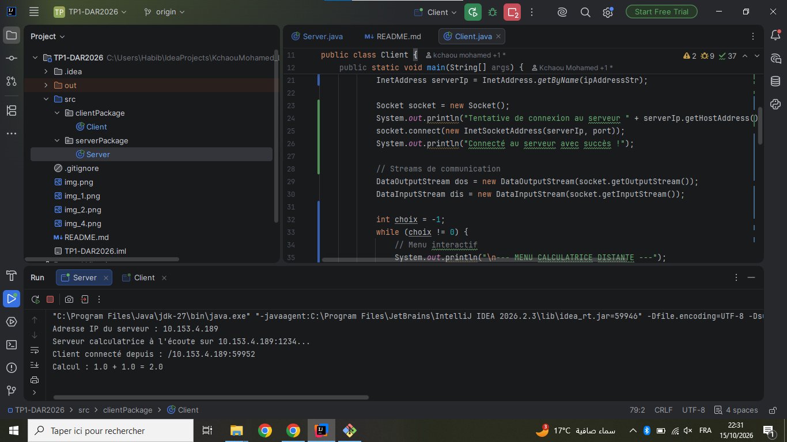
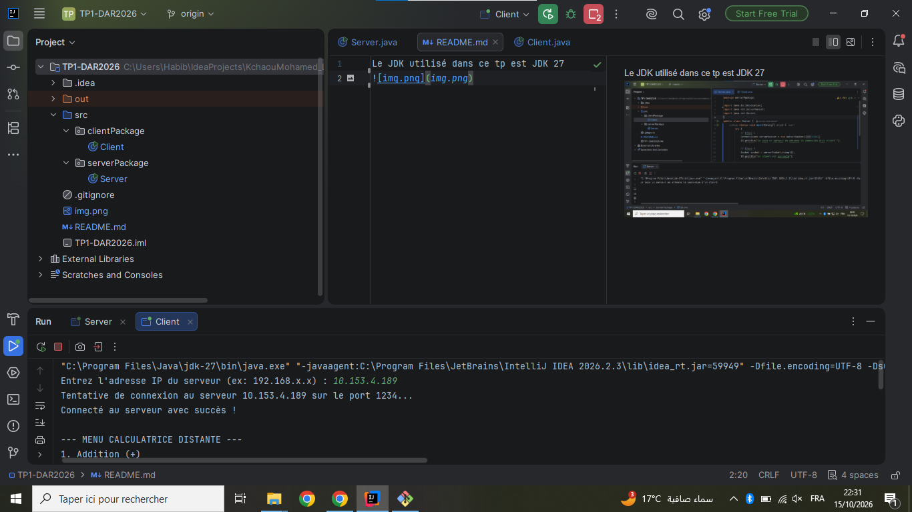
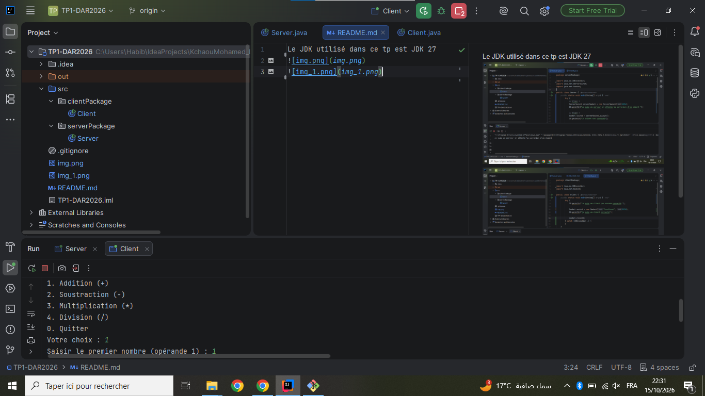
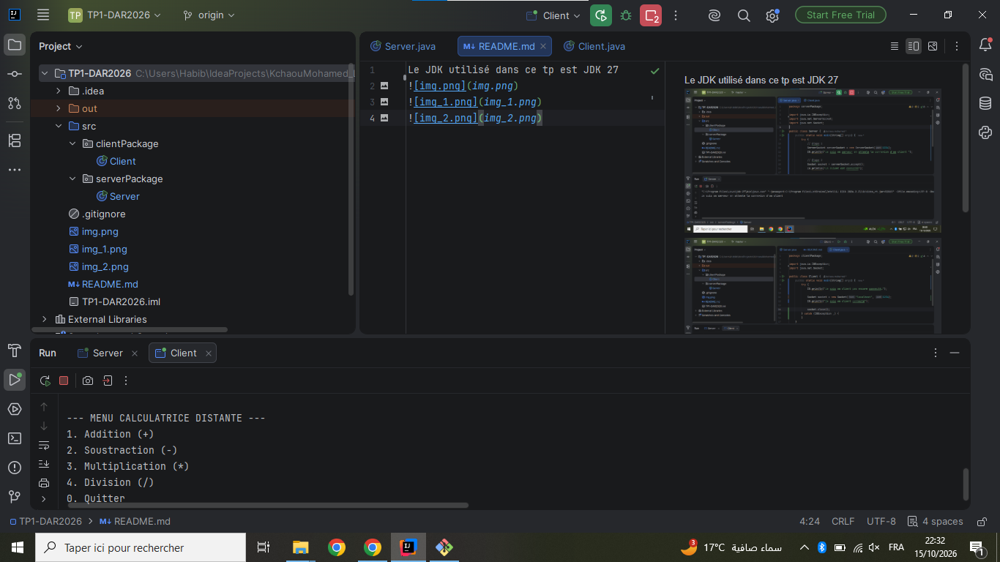

# TP1 — Activité 1-3 : Calculatrice TCP sur le réseau

**Mohamed Kchaou** · LSI 3 · Développement d’applications réparties

## Objectif

Permettre à un client de demander un calcul à un serveur TCP, y compris lorsque les deux programmes tournent sur des machines différentes du réseau local.

## Fonctionnement

Le serveur se lie à son adresse réseau et écoute sur le port `1234`. Le client demande l’adresse IP du serveur, affiche un menu et transmet l’opération choisie ainsi que ses deux opérandes. Le serveur réalise l’addition, la soustraction, la multiplication ou la division, puis renvoie le résultat. Le programme signale une division par zéro. Dans cette version, le serveur accepte un client par lancement.

## Exécution

1. Démarrer le serveur et relever l’adresse IP affichée dans sa console.
2. Sur le client, saisir cette adresse puis choisir une opération et ses opérandes.
3. Pour un test sur une seule machine, saisir `localhost` ou l’adresse de boucle locale proposée par le programme.

Le pare-feu de la machine serveur doit autoriser les connexions entrantes sur le port `1234` pour un essai entre machines.

## Captures

## Synthèse

Cette étape réutilise TCP pour transporter une requête structurée entre deux machines et une réponse calculée. Le client choisit la destination et l’opération, tandis que le serveur centralise le calcul.
