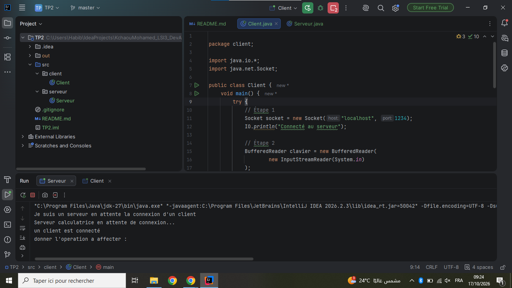
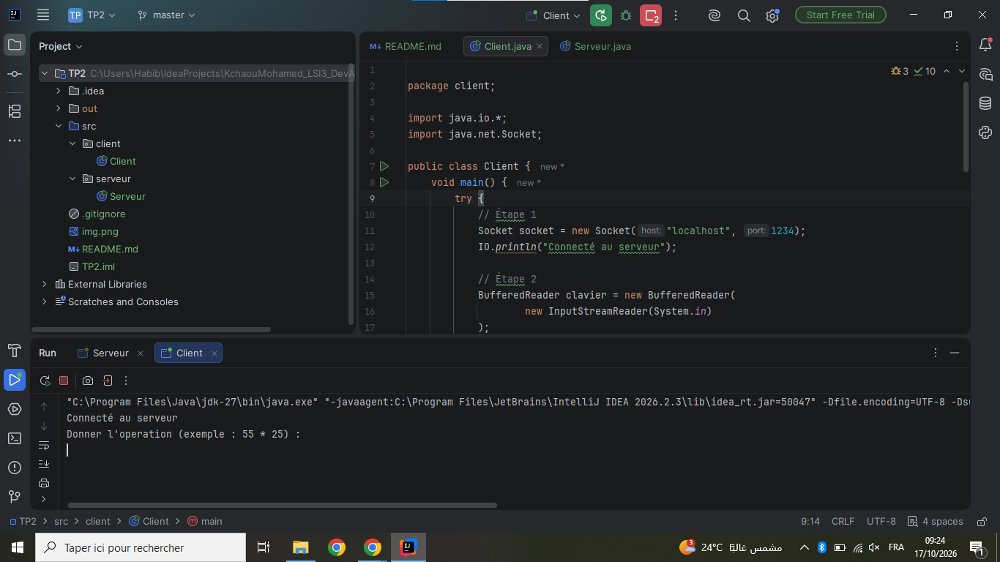
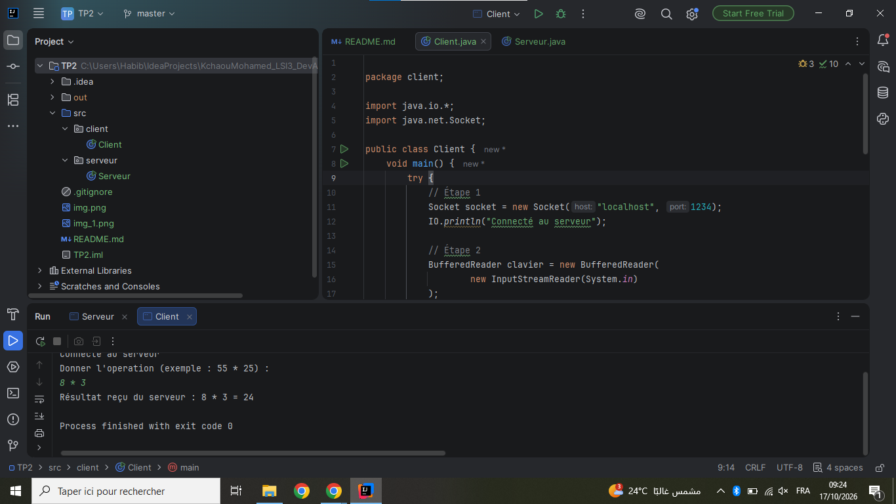

# TP2 — Activité 2-1 : Calculatrice avec requête textuelle

**Mohamed Kchaou** · LSI 3 · Développement d’applications réparties

## Objectif

Échanger une commande de calcul complète sous forme de texte entre un client et un serveur TCP.

## Fonctionnement

Le client transmet une expression sous la forme `55 * 25`. Le serveur lit la ligne, sépare les deux entiers et l’opérateur, effectue le calcul et renvoie le résultat sous forme de texte. Le code prend en charge `+`, `-`, `*` et `/` en arithmétique entière. Une requête est traitée par connexion, sur le port `1234`.

## Exécution

1. Lancer le serveur et attendre son message d’écoute.
2. Exécuter le client, saisir les deux entiers et l’opérateur demandé.
3. Lire le résultat renvoyé par le serveur.

Le client se connecte à `localhost`. Pour tester sur un réseau local, adapter l’adresse dans le code client. Les sources utilisent `java.io.IO.println` et une méthode `void main()` ; elles nécessitent un JDK récent pour compiler telles quelles.

## Captures

## Synthèse

Une chaîne unique transporte toutes les informations de la demande. Le serveur doit interpréter son contenu avant de pouvoir calculer ; la représentation est lisible, mais dépend du format de texte attendu.
