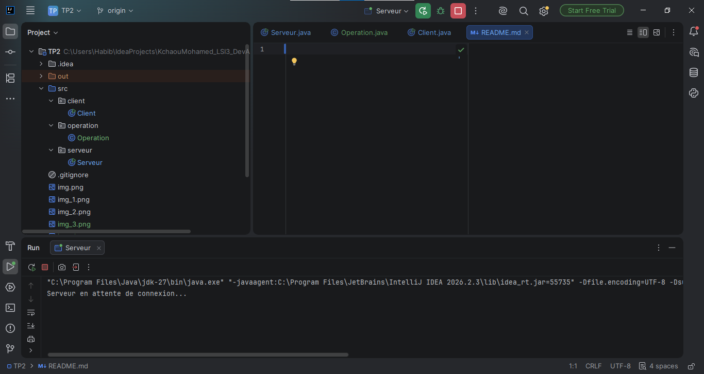
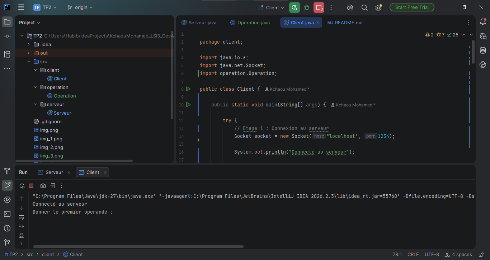
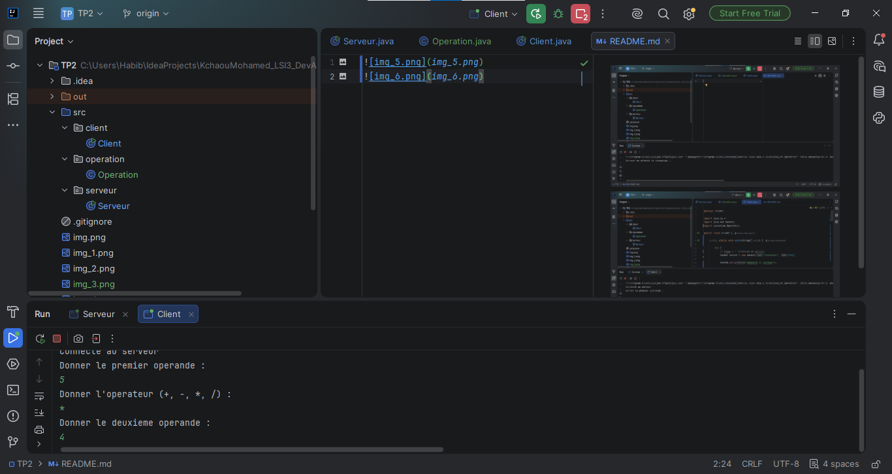
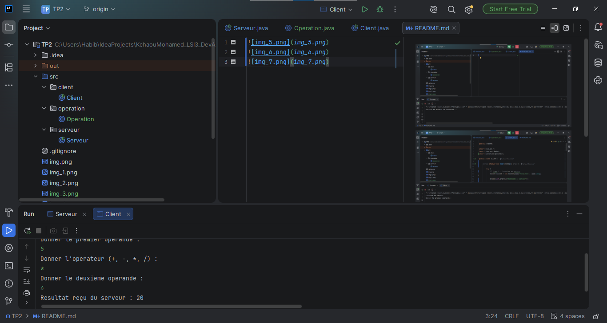

# TP2 — Activité 2-2 : Calculatrice avec objet sérialisé

**Mohamed Kchaou** · LSI 3 · Développement d’applications réparties

## Objectif

Remplacer la commande textuelle par un objet Java sérialisable qui contient les données nécessaires au calcul.

## Fonctionnement

La classe `Operation` transporte les deux opérandes entiers et l’opérateur. Le client crée un `ObjectOutputStream`, envoie l’objet au serveur puis lit la réponse avec un `ObjectInputStream`. Le serveur désérialise la requête, effectue l’une des quatre opérations (`+`, `-`, `*`, `/`) et renvoie un entier. Le client vérifie que l’opérateur est reconnu et que le diviseur n’est pas nul. Une opération est traitée par connexion sur le port `1234`.

## Exécution

1. Démarrer le serveur.
2. Lancer le client, saisir les deux entiers et choisir l’opérateur.
3. Vérifier le résultat reçu ; par exemple `5 * 4` renvoie `20`.

## Captures

## Synthèse

La sérialisation permet d’envoyer une structure typée plutôt qu’une ligne à découper. Le client et le serveur doivent partager la même définition de `Operation` et rester compatibles sur les types transmis.
