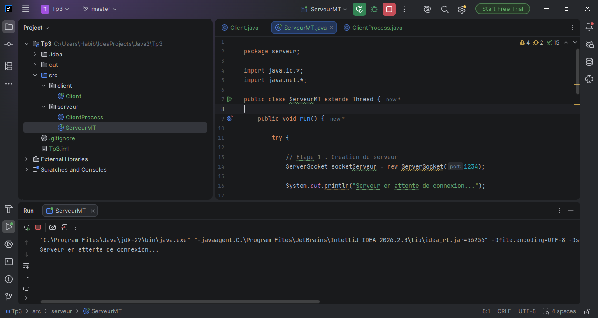
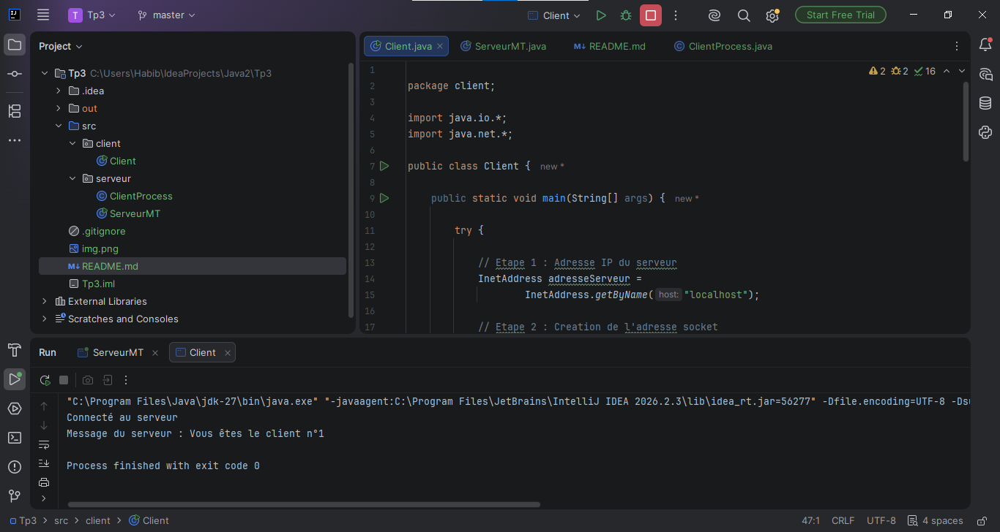
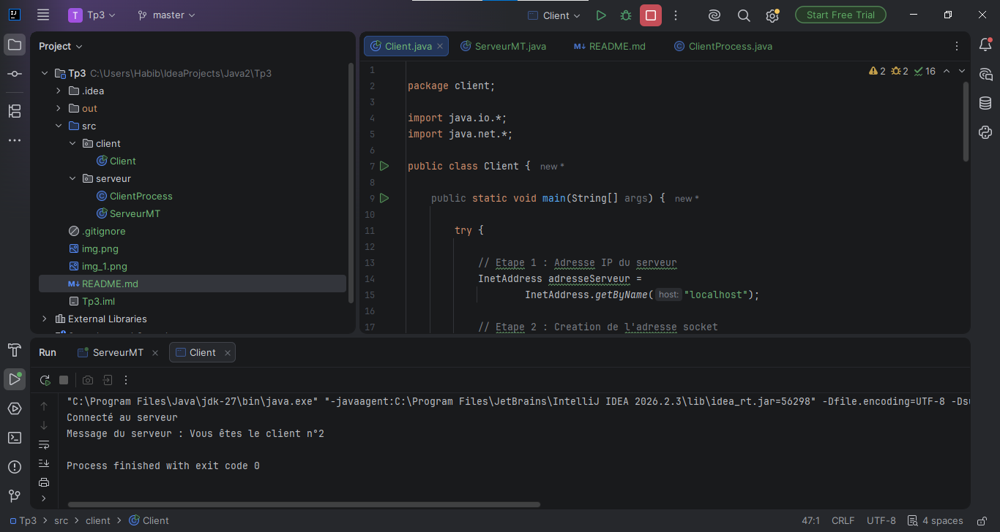
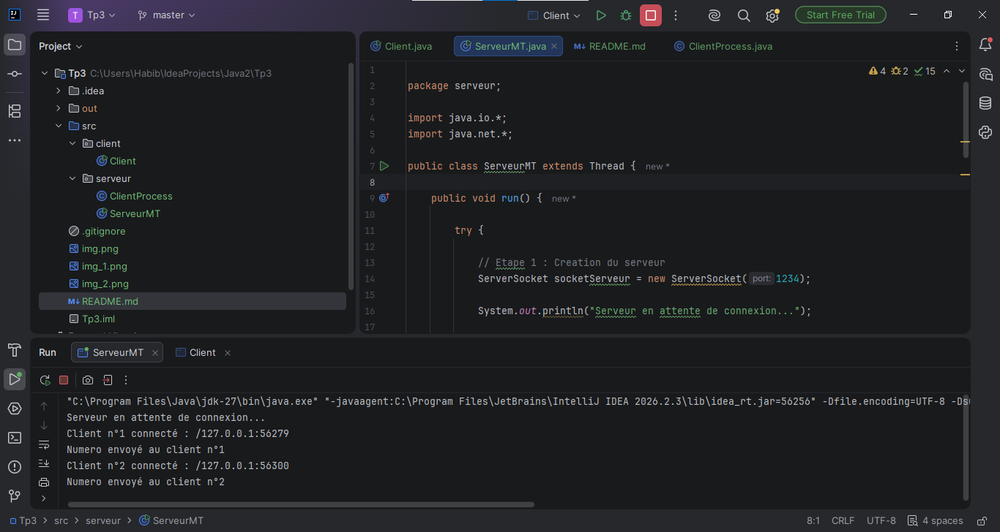

# TP3 — Activité 3-1 : Serveur TCP multithread

**Mohamed Kchaou** · LSI 3 · Développement d’applications réparties

## Objectif

Accepter plusieurs connexions TCP et traiter chaque client indépendamment, sans bloquer l’acceptation des connexions suivantes.

## Fonctionnement

`ServerMT` écoute sur le port `1234` et accepte les clients dans une boucle. Pour chaque socket, il crée un thread `ClientProcess`, affiche l’adresse distante et attribue un numéro d’ordre. Le gestionnaire renvoie ce numéro au client puis ferme la connexion. Le client fourni se connecte à `localhost`.

## Exécution et essais

1. Lancer `ServerMT` et le laisser écouter.
2. Ouvrir plusieurs clients ou clients Telnet vers le port `1234`.
3. Vérifier que chacun reçoit son numéro et que le serveur affiche son adresse.

Pour tester depuis une autre machine, remplacer `localhost` dans le client par l’adresse IP du serveur et autoriser le port `1234` dans le pare-feu.

## Captures

## Synthèse

Le thread principal reste disponible pour accepter de nouvelles sockets. Le traitement de chaque connexion est confié à un thread distinct, ce qui permet de servir plusieurs clients à la fois.
