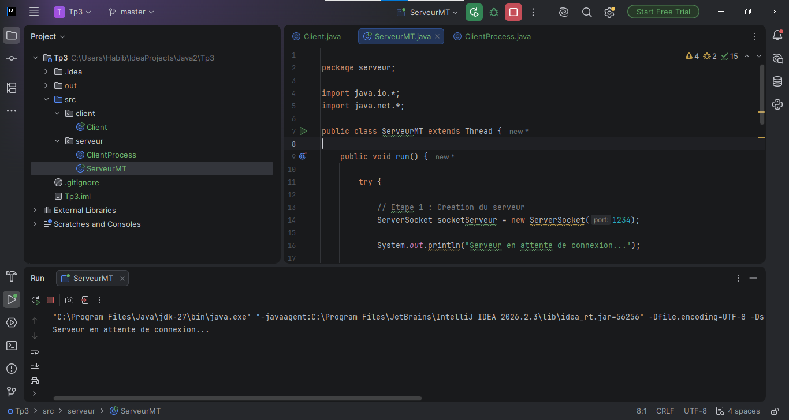
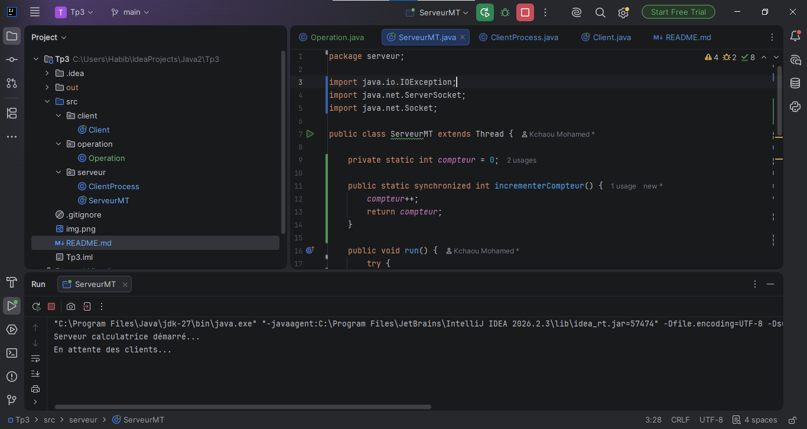
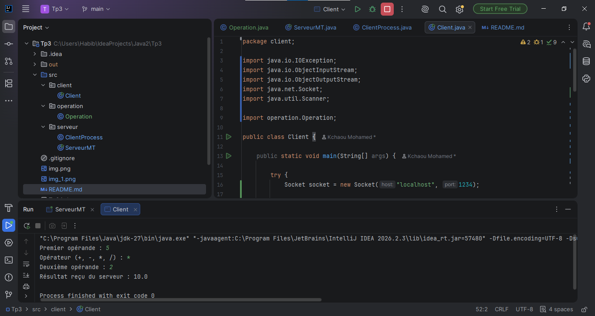
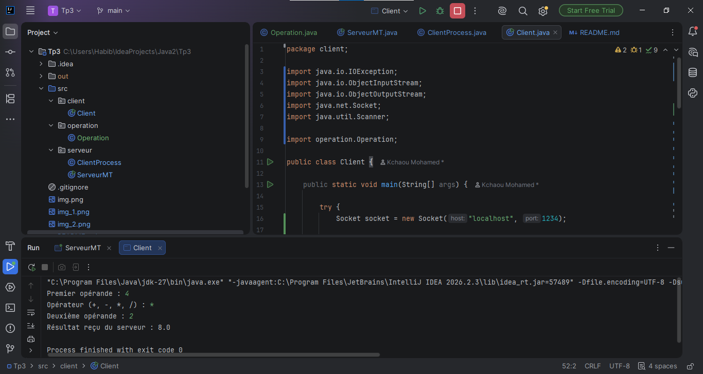
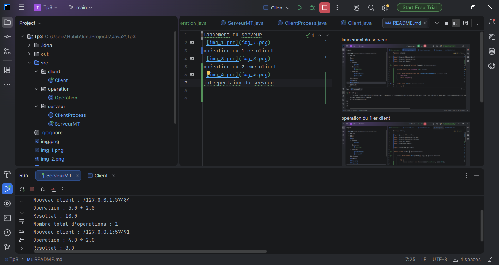

# TP3 — Activité 3-2 : Calculatrice TCP multithread

**Mohamed Kchaou** · LSI 3 · Développement d’applications réparties

## Objectif

Combiner le traitement multithread des clients avec le calcul distribué basé sur des objets sérialisés.

## Fonctionnement

Le serveur écoute sur le port `1234` et crée un `ClientProcess` pour chaque connexion. Le client envoie un objet `Operation` contenant deux nombres et l’opérateur ; le serveur calcule puis renvoie le résultat. Les quatre opérations sont prises en charge et une division par zéro est rejetée. Le compteur des opérations est partagé et protégé par synchronisation afin de conserver un total cohérent quand plusieurs threads travaillent en même temps. Chaque connexion traite une opération.

## Exécution et essais

1. Lancer le serveur multithread.
2. Démarrer plusieurs clients et envoyer des opérations.
3. Comparer les résultats reçus par les clients avec le compteur affiché par le serveur.

Le client se connecte à `localhost` par défaut. Pour un essai sur le réseau local, remplacer cette adresse par celle du serveur.

## Captures

## Synthèse

Cette activité réunit les objets sérialisés du TP2 et les threads du TP3. La synchronisation protège le compteur commun, tandis que chaque client conserve sa propre connexion et son propre traitement.
