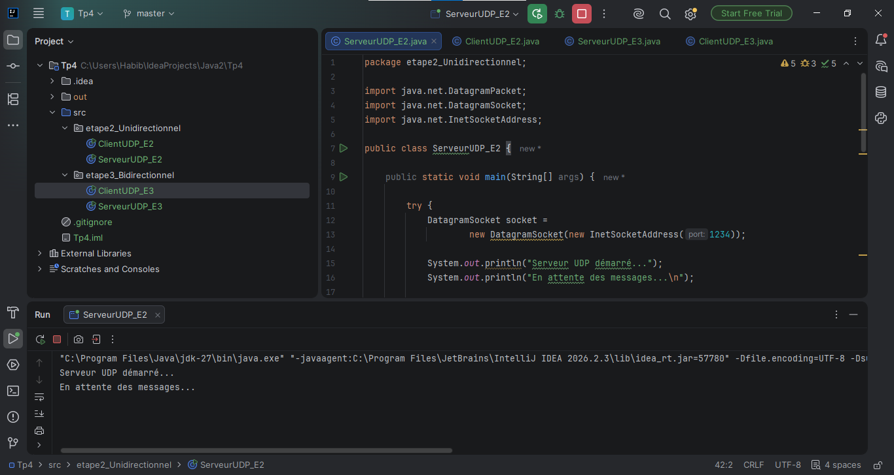
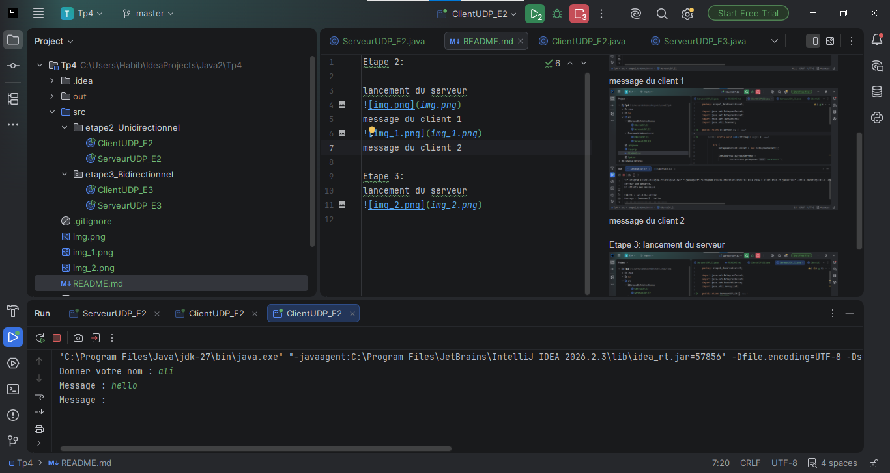
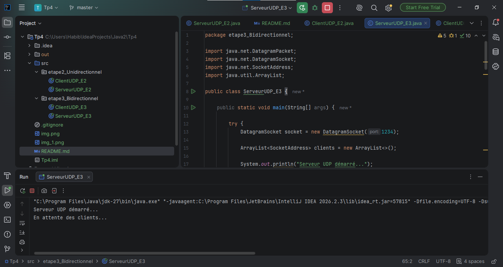
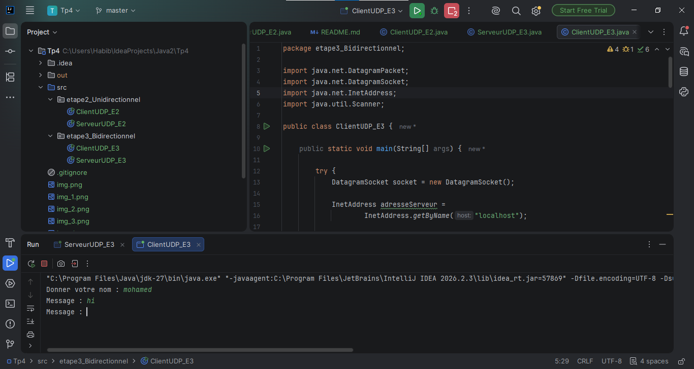
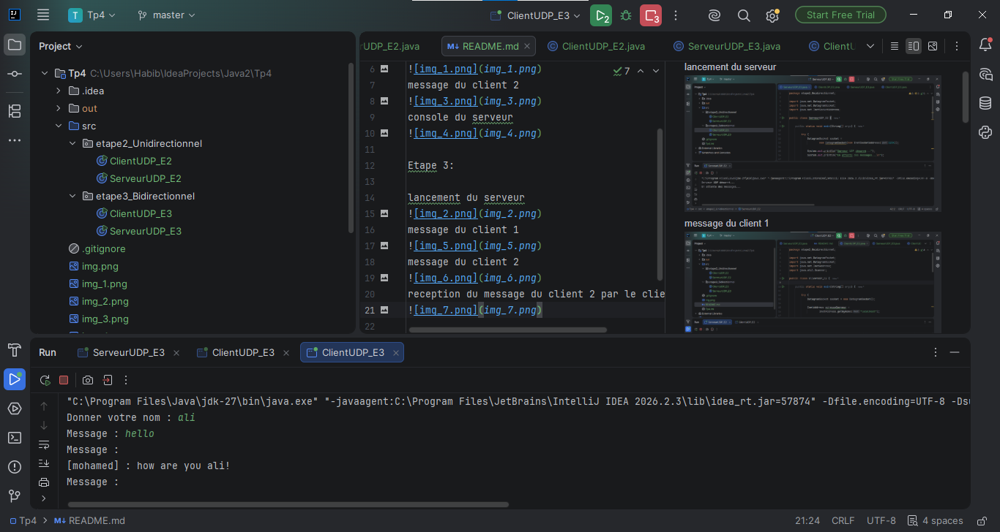

# TP4 — Activité 1 : Messagerie UDP

**Mohamed Kchaou** · LSI 3 · Développement d’applications réparties

## Objectif

Mettre en place une messagerie avec des datagrammes UDP, d’abord du client vers le serveur, puis entre plusieurs clients via une diffusion par le serveur.

## Étape 2 — Envoi unidirectionnel

Le serveur écoute sur le port `1234` et affiche chaque message reçu avec l’adresse IP et le port de l’émetteur. Le client demande un nom et préfixe les messages sous la forme `[nom] : message`. Le serveur ne renvoie pas de message dans cette étape.

## Étape 3 — Échange bidirectionnel

Le serveur conserve les adresses des clients qui lui envoient un datagramme. Il transmet ensuite chaque message aux autres adresses enregistrées. Le client lance un thread de réception séparé, ce qui lui permet d’écouter les messages tout en continuant à envoyer les siens.

1. Démarrer le serveur de l’étape 3.
2. Démarrer au moins deux clients avec des noms distincts.
3. Envoyer un message depuis un client et vérifier sa réception par l’autre.

Le code client utilise `localhost` ; pour un test sur plusieurs machines, adapter l’adresse du serveur. Les datagrammes UDP n’établissent pas de connexion et ne garantissent pas la livraison des messages.

## Synthèse

Le serveur devient un relais entre les clients en mémorisant les adresses de destination. L’écoute dans un thread dédié permet à chaque client de recevoir les messages diffusés pendant qu’il saisit les siens.
