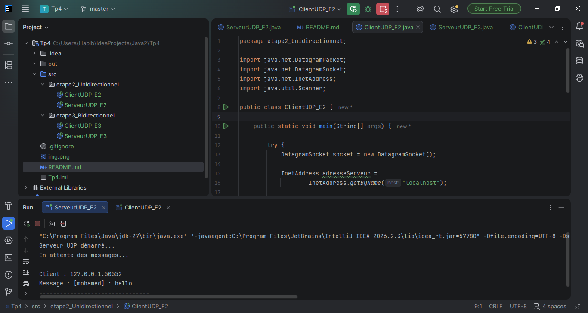
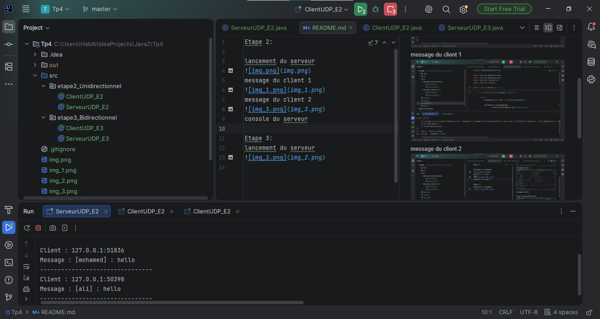
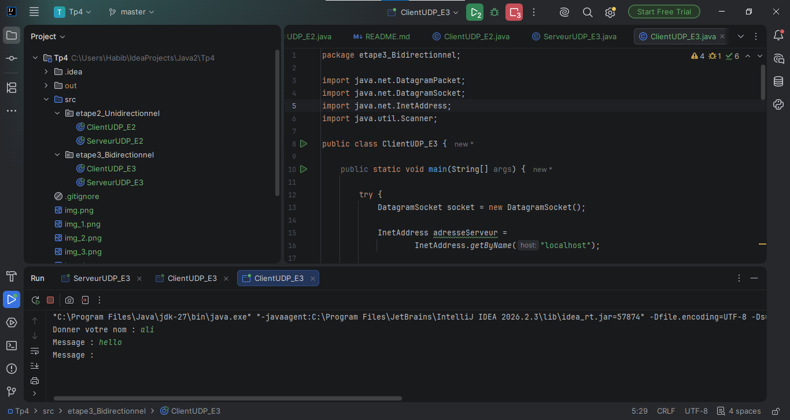
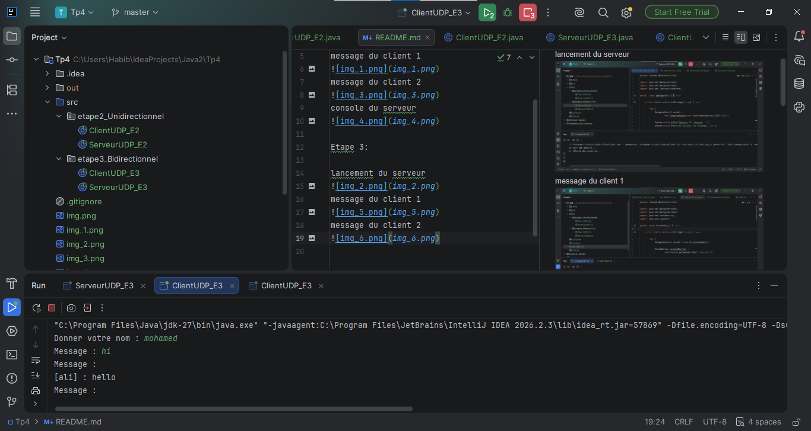

# Tp_4

Etape 2 unidirectionnel:

lancement du serveur

message du client 1

message du client 2

console du serveur

Etape 3 bidirectionnel:

lancement du serveur

message du client 1

message du client 2

reception du message du client 2 par le client 1

aussi bien pour le client 2
