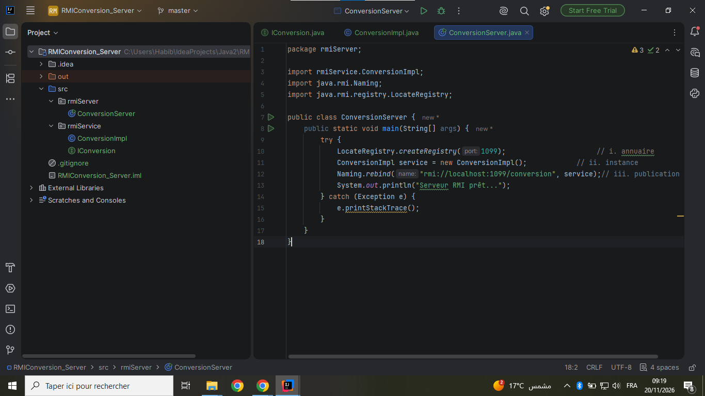
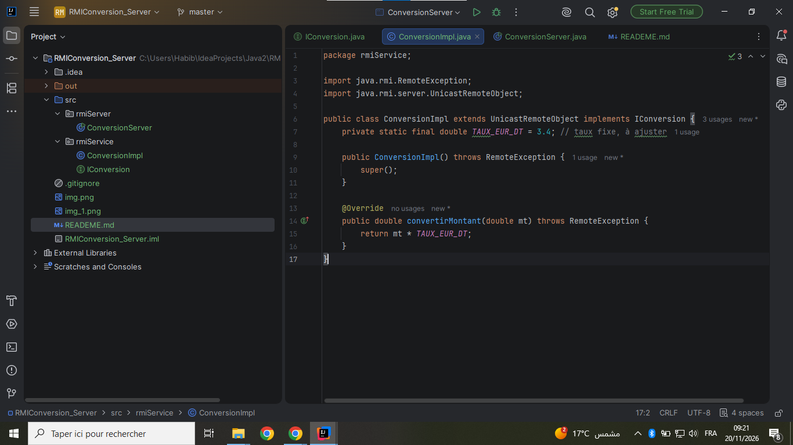
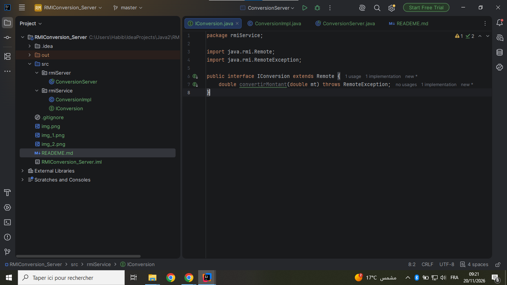
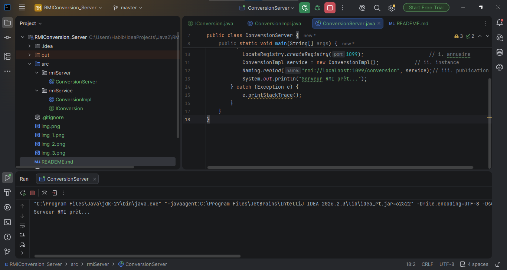
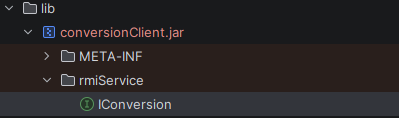
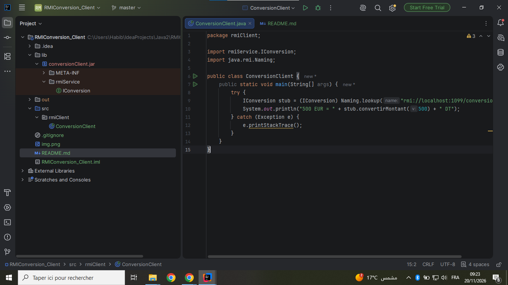
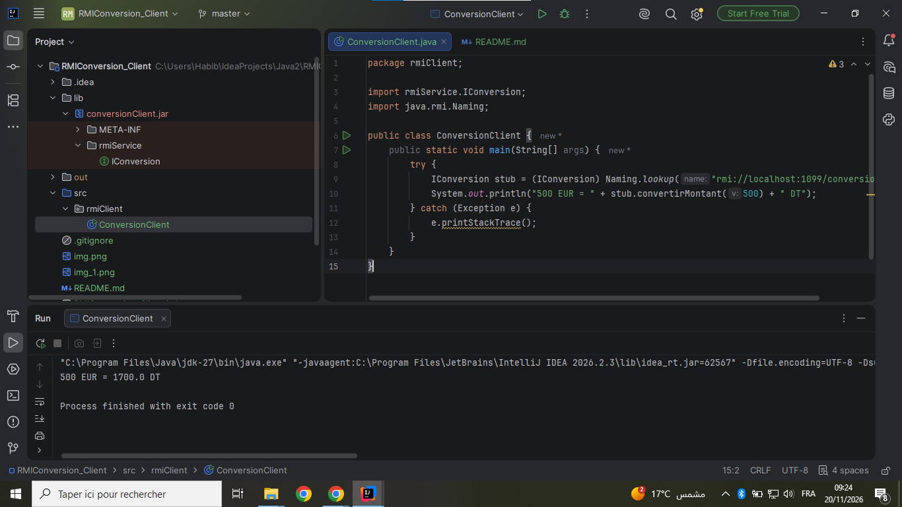

# TP5 — Activité 5-1 : Conversion de devise avec RMI

**Mohamed Kchaou** · LSI 3 · Développement d’applications réparties

Cette activité contient les deux projets nécessaires : `RMIConversion_Server` publie le service, et `RMIConversion_Client` le retrouve et appelle sa méthode distante.

## Objectif et fonctionnement

L’interface distante `IConversion` déclare `convertirMontant`. L’implémentation serveur applique le taux fixe de **3,4 DT pour 1 EUR**. Le serveur crée le registre RMI sur le port `1099` et associe le service au nom `conversion`. Le client effectue une recherche dans le registre puis appelle la méthode ; le scénario fourni convertit `500 EUR`, soit `1 700 DT`.

## Exécution

1. Ouvrir les projets client et serveur dans l’IDE.
2. Lancer `ConversionServer` et vérifier que le service est publié sur le registre `1099`.
3. Lancer `ConversionClient` et lire le montant converti.
4. Si les projets sont séparés, vérifier que le client dispose du JAR contenant l’interface distante et que sa version correspond à celle du serveur.

## Captures du serveur

## Captures du client

## Synthèse

RMI permet au client d’utiliser l’interface distante comme un contrat d’appel. Le registre fournit la référence de l’objet, puis l’appel à `convertirMontant` est exécuté sur le serveur.
