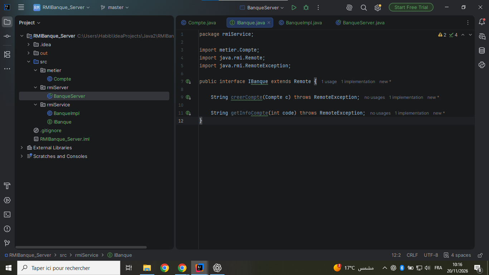
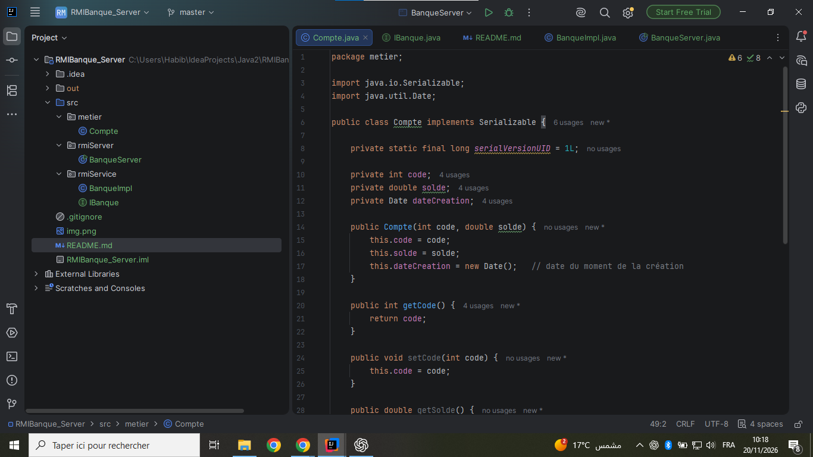
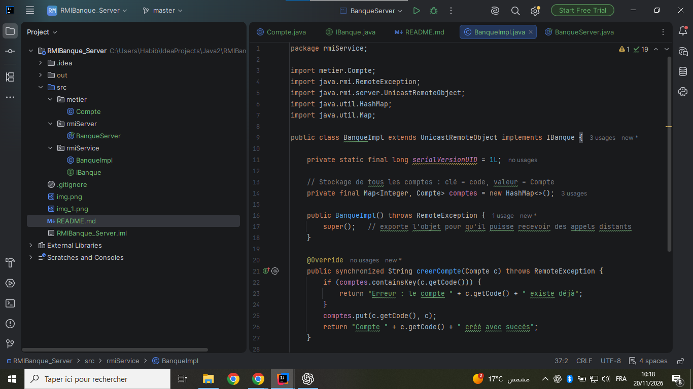
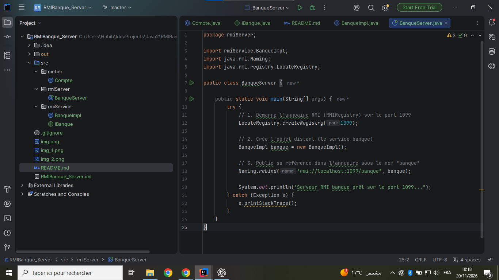
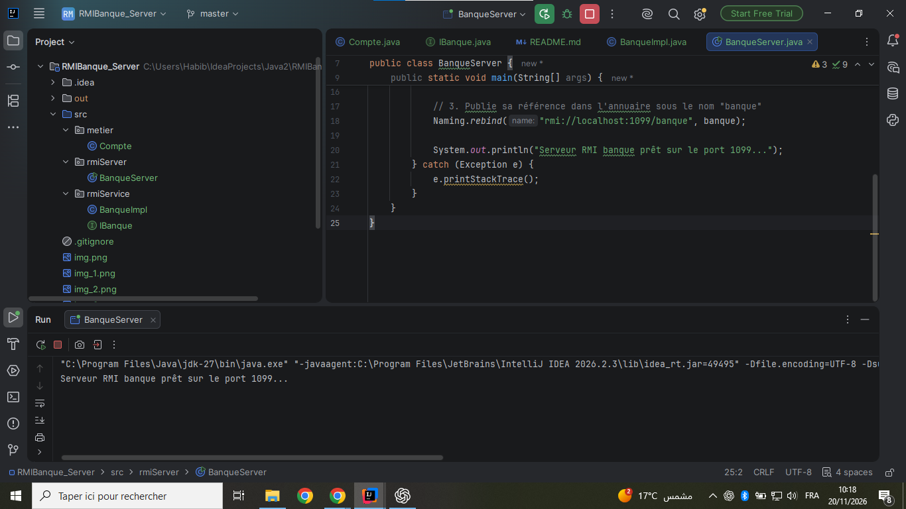
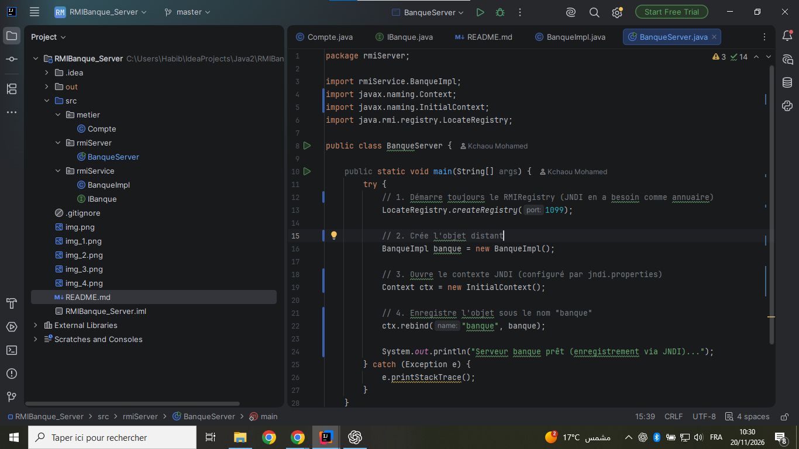
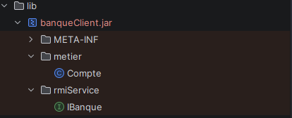
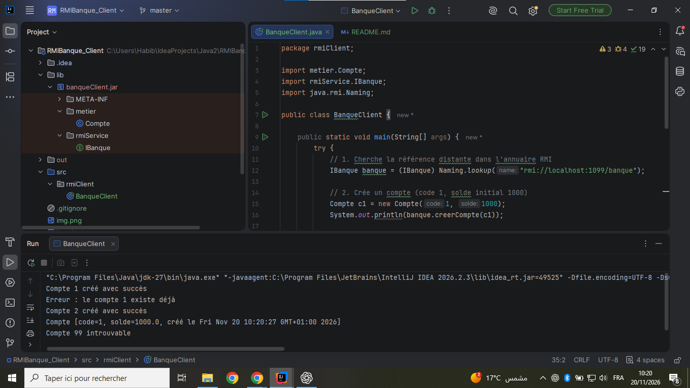
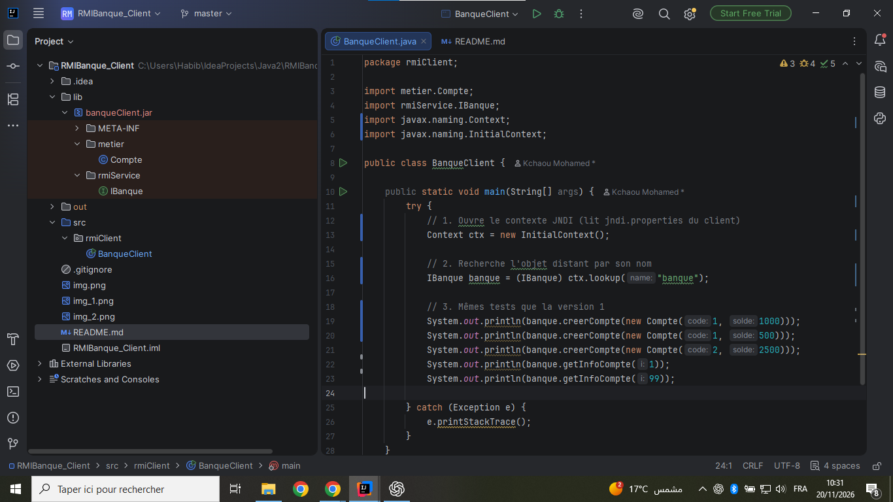

# TP5 — Activité 5-2 : Service bancaire RMI avec JNDI

**Mohamed Kchaou** · LSI 3 · Développement d’applications réparties

Cette activité met en place un service bancaire distant en deux versions : une première recherche directe dans le registre RMI sans JNDI, puis une version qui publie et recherche le service avec JNDI. Les projets consultables actuellement sont dans `RMIBanque_Server` et `RMIBanque_Client`.

## Fonctionnement

Le serveur expose `IBanque`. La classe sérialisable `Compte` contient un code, un solde et une date. `BanqueImpl` conserve les comptes en mémoire, refuse un code déjà utilisé et renvoie une information d’erreur pour un compte inconnu. Les méthodes de gestion sont synchronisées.

Dans la version actuelle, le serveur publie l’objet avec JNDI et le client le récupère avec `InitialContext.lookup`. Les versions précédentes sans JNDI sont conservées dans l’historique Git ci-dessous.

## Scénario fourni

Le client tente de créer le compte 1 avec un solde de 1 000, de le recréer, puis crée le compte 2 avec 2 500. Il consulte ensuite le compte 1 et un code inexistant (`99`). Le second essai sur le code 1 doit être refusé.

## Exécution

1. Lancer `BanqueServer` et laisser le serveur RMI actif.
2. Exécuter `BanqueClient` pendant que le serveur tourne.
3. Vérifier la création des comptes, le refus du doublon et la réponse du code inconnu.

Consulter les paramètres de `jndi.properties` dans les projets si l’adresse du serveur ou le registre doit être adapté.

## Captures du serveur

## Captures du client

## Historique des versions

### Client — `RMIBanque_Client`

- **Sans JNDI :** [commit `e1d7089`](https://github.com/kchaou-world/TP-DAR-2026/commit/e1d7089d215771910dd8511a3976ddeb39d696e8)
- **Avec JNDI :** [commit `bc82e5d`](https://github.com/kchaou-world/TP-DAR-2026/commit/bc82e5d010f8c82b67ea2e629a84832f0ffea9eb)
- **Historique complet :** [branche `history/RMIBanque_Client`](https://github.com/kchaou-world/TP-DAR-2026/tree/history/RMIBanque_Client)

### Serveur — `RMIBanque_Server`

- **Sans JNDI :** [commit `a3cab67`](https://github.com/kchaou-world/TP-DAR-2026/commit/a3cab679174baed4bafe6ed27ad1478d0b874e42)
- **Avec JNDI :** [commit `0e7b208`](https://github.com/kchaou-world/TP-DAR-2026/commit/0e7b208eec171db561faad5c8736b8b94bbd4816)
- **Historique complet :** [branche `history/RMIBanque_Server`](https://github.com/kchaou-world/TP-DAR-2026/tree/history/RMIBanque_Server)

## Synthèse

RMI transporte les appels vers le service bancaire et JNDI fournit un nom logique pour retrouver sa référence. La version sans JNDI ainsi que la version avec JNDI restent consultables dans les commits et branches dédiés.
