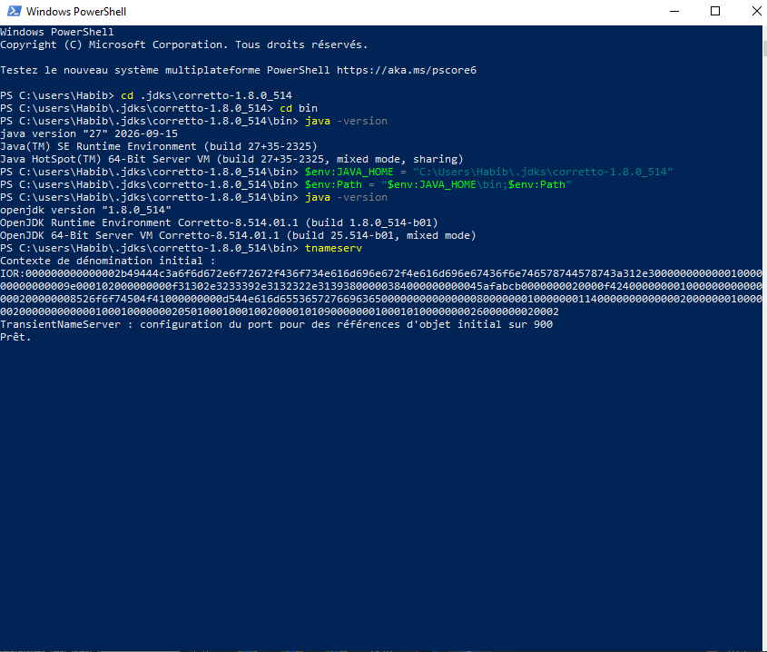
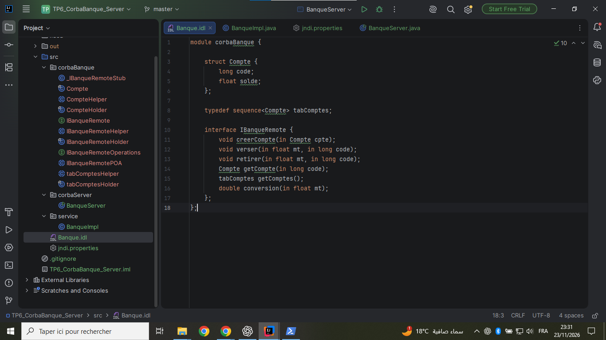
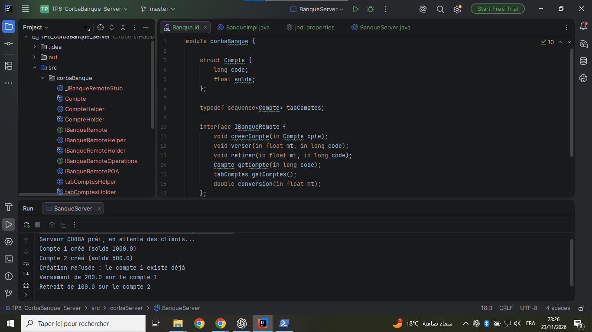
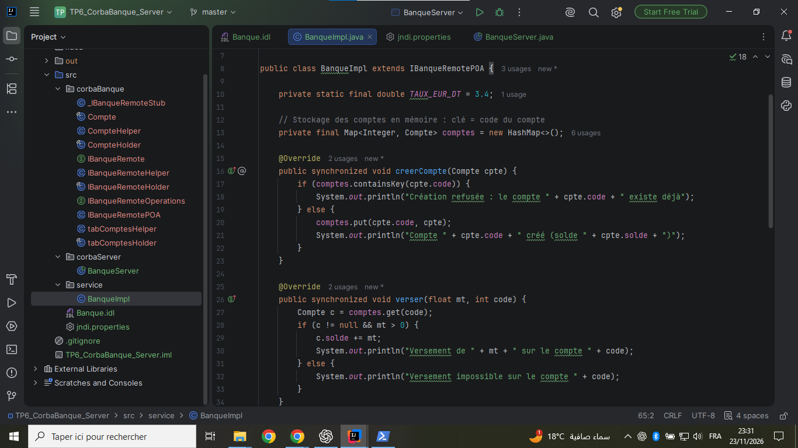
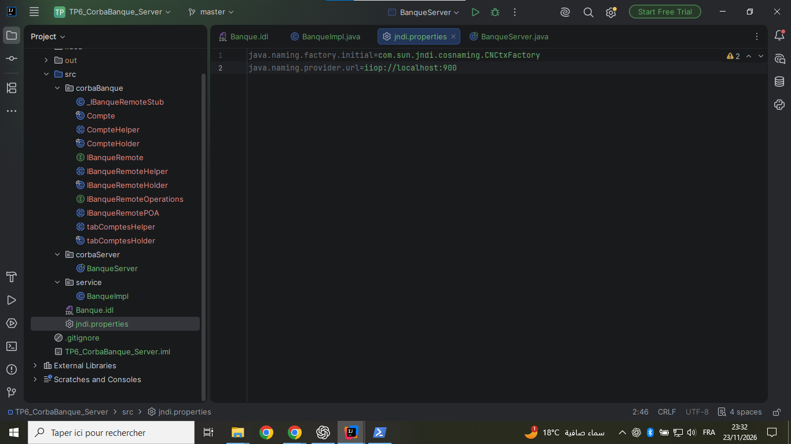
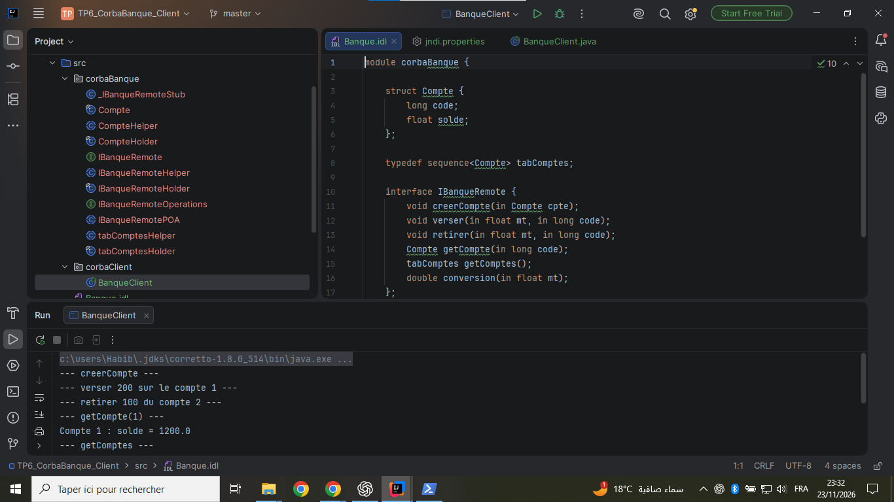
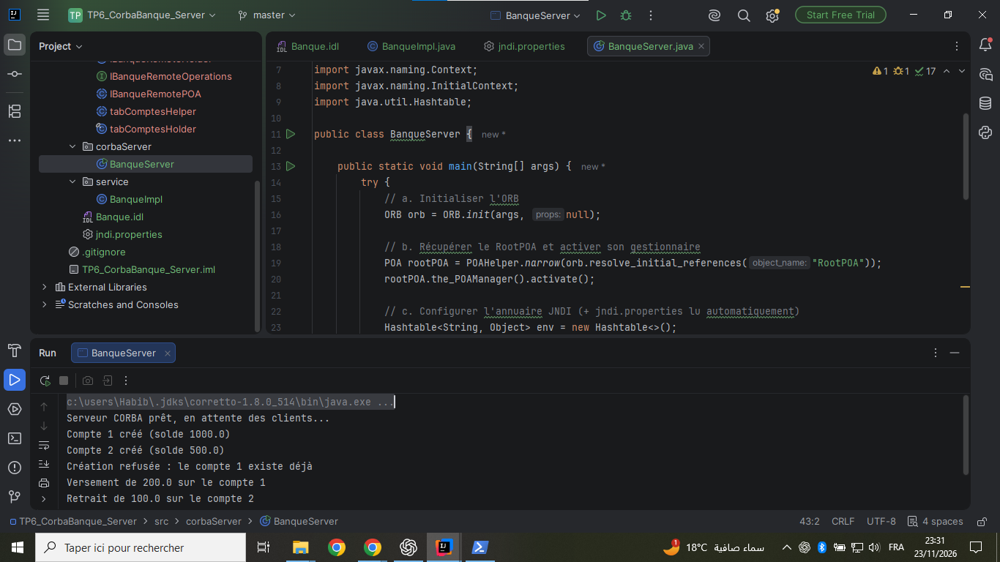
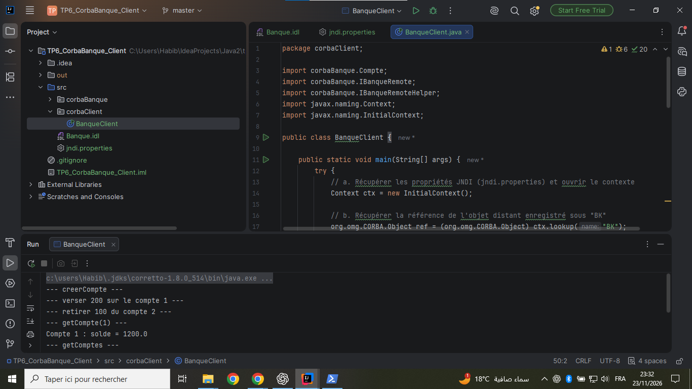

# TP6 — Service bancaire distribué avec CORBA

**Mohamed Kchaou** · LSI 3 · Faculté des Sciences de Sfax · 2026–2027

Ce TP met en œuvre un service bancaire distribué en Java. Le serveur gère les comptes en mémoire. Le client retrouve le service dans l’annuaire CORBA et appelle ses six opérations à distance.

## 1. Préparation de l’environnement

Ouvrir les projets `TP6_CorbaBanque_Server` et `TP6_CorbaBanque_Client` dans IntelliJ IDEA et choisir un **JDK 8** pour les deux. Dans PowerShell, vérifier que `java -version` affiche une version `1.8`. Si le terminal utilise un autre JDK, ajuster `JAVA_HOME` et placer le dossier `bin` du JDK 8 en tête du `Path` de la session.

*PowerShell utilise Corretto 8 après la mise à jour du chemin. La capture montre aussi le démarrage de l’annuaire sur le port 900.*



## 2. Développement du serveur

Le fichier `TP6_CorbaBanque_Server/src/Banque.idl` définit le module `corbaBanque`, la structure `Compte` (code de type `long` et solde de type `float`), la séquence `tabComptes` et l’interface distante `IBanqueRemote`.

Depuis le dossier `src` du serveur, la commande suivante génère le package Java `corbaBanque`, qui contient notamment le stub et la classe de base du servant.

```powershell
idlj -fall -v Banque.idl
```





La classe `service.BanqueImpl` hérite de `IBanqueRemotePOA` et stocke les comptes dans une `HashMap` indexée par code. Elle refuse les créations en double ainsi que les retraits qui dépassent le solde. La conversion utilise le taux fixe de **3,4 DT pour 1 EUR**.



Le fichier `jndi.properties` de chaque projet configure le fournisseur JNDI `com.sun.jndi.cosnaming.CNCtxFactory` et l’adresse `iiop://localhost:900`. La classe `corbaServer.BanqueServer` initialise l’ORB, active le gestionnaire du `RootPOA`, publie la référence du servant sous le nom `BK`, puis attend les requêtes avec `orb.run()`.



## 3. Développement du client

Le dossier `TP6_CorbaBanque_Client/src` contient une copie de `Banque.idl` et de `jndi.properties`. Depuis ce dossier, exécuter la même commande `idlj -fall -v Banque.idl` pour générer les classes côté client.



La classe `corbaClient.BanqueClient` récupère la référence `BK` avec `InitialContext.lookup`, puis utilise `IBanqueRemoteHelper.narrow` pour obtenir un stub typé. Elle appelle ensuite les six méthodes de l’interface distante.

## 4. Exécution et résultats

1. Dans un terminal configuré avec le JDK 8, lancer `tnameserv -ORBInitialPort 900` et laisser le terminal ouvert.
2. Dans IntelliJ, lancer `corbaServer.BanqueServer` et attendre le message « Serveur CORBA prêt, en attente des clients... ».
3. Lancer `corbaClient.BanqueClient` pendant que l’annuaire et le serveur tournent. Pour rejouer le scénario sur des comptes vides, redémarrer le serveur avant de relancer le client.

*La console du serveur affiche les deux créations, le refus du doublon, le versement et le retrait.*



*La console du client indique un solde de 1 200 pour le compte 1 après le versement.*



| Opération | Résultat attendu pour un serveur fraîchement démarré |
| --- | --- |
| `creerCompte` | Compte 1 créé avec 1 000, compte 2 avec 500, deuxième création du compte 1 refusée |
| `verser` | Versement de 200 sur le compte 1 |
| `retirer` | Retrait de 100 sur le compte 2 |
| `getCompte` | Solde du compte 1 égal à 1 200 |
| `getComptes` | Comptes 1 et 2 listés avec les soldes de 1 200 et 400 |
| `conversion` | 500 EUR donnent 1 700 DT |

## 5. Dépôt des livrables

Le dépôt GitHub doit contenir les deux projets, ce README et le dossier `photos_tp6`. Le lien du dépôt est à remettre dans l’espace de dépôt de l’ENT.

## Synthèse

Le contrat IDL permet au client et au serveur de partager les mêmes types et signatures. L’annuaire associe le nom `BK` à la référence du service, et le stub permet au client d’invoquer les opérations de `BanqueImpl`. Les soldes sont conservés en mémoire pendant l’exécution du serveur.

